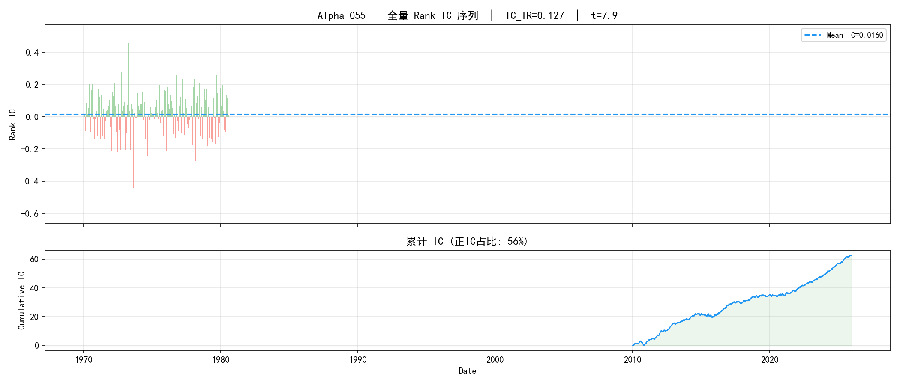
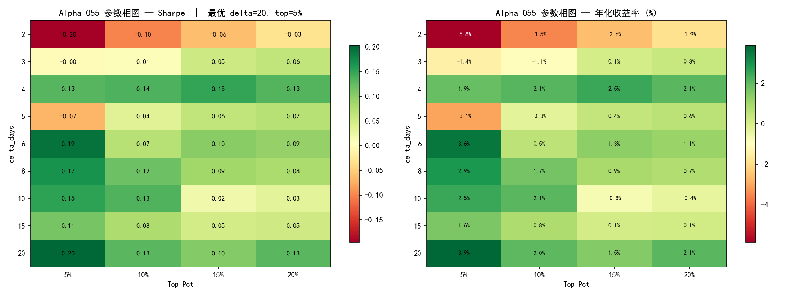
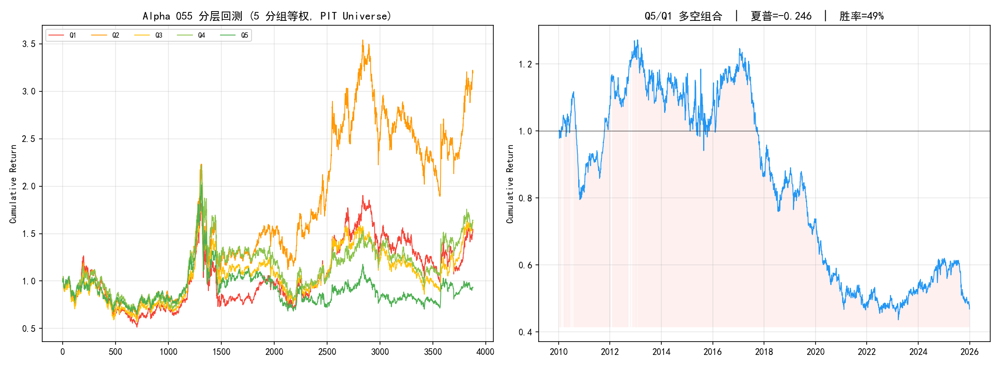
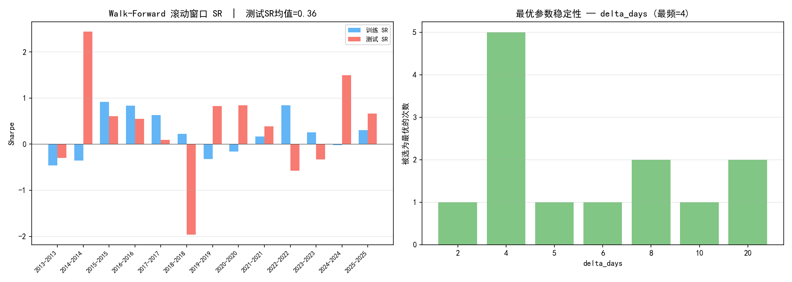
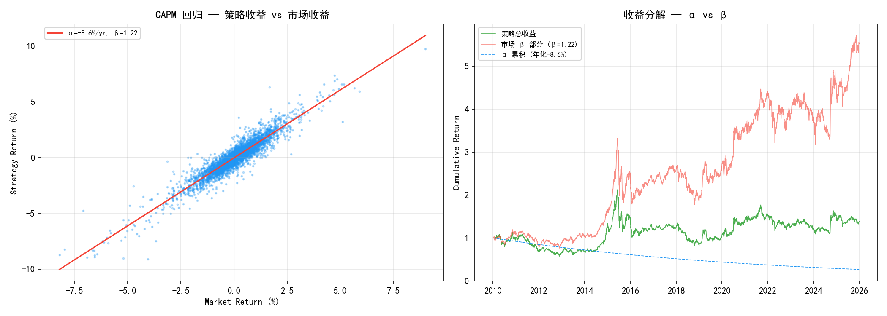
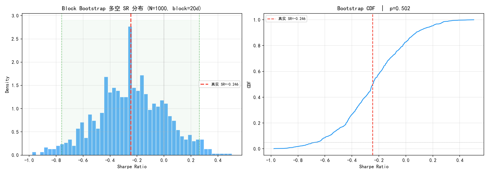

# Alpha 055 深度分析 — DELTA×Volume 反转因子

> 本报告由 `report.py` 于 **2026-10-24** 在 Alpha191 口径修复后重跑生成。
> 此前该目录只有脚本与图，没有 markdown 报告；本文件是首次成文。
> 口径：PIT 全历史缓存 813 只（含退市股）、3886 个交易日、后复权因子、真 VWAP。
> 复现：`.venv/Scripts/python.exe strategies/alpha055_trial/report.py`

---

## 结论先行

**Alpha 055 作为独立多空信号不成立。**

| 维度 | 结果 | 判定 |
|---|---|---|
| Rank IC 均值 | 0.0160 | 弱正 |
| IC_IR | 0.127 | 弱 |
| IC t 值 | 7.90 | 显著（但 IC_IR 低，信噪比差） |
| 分层单调性 | Q1 2.9% / Q2 7.9% / Q3 3.2% / Q4 3.3% / Q5 −0.5% | **不单调** |
| 多空（Q5−Q1）夏普 | **−0.246** | **方向为负** |
| 多空胜率 | 49.0% | 等同抛硬币 |
| Bootstrap P(SR>0) | 17.3% | 不显著 |
| CAPM α t 值 | −3.69 | 显著**负** alpha |

**因子公式**：`-1 × RANK(ABS(DELTA(CLOSE, d))) × RANK(DELTA(VOLUME, d))`，`d` 默认 4。
表达「价格大幅变动 + 成交量放大 → 后续反转」，是典型的量价突变反转因子。

---

## 1. IC 分析

| 指标 | 数值 |
|---|---|
| 截面平均股票数 | 696 |
| Rank IC 均值 | **0.0160** |
| Rank IC 标准差 | 0.1265 |
| IC_IR | **0.127** |
| t 值 | 7.90 |
| 正 IC 占比 | 56.3% |

IC 均值显著为正（t=7.90），但 IC_IR 只有 0.127——日均 IC 的波动（std 0.1265）
是均值的 8 倍。**统计显著 ≠ 经济可用**：t 值大是因为 3886 天样本长，不是因为信号稳定。

## 2. 参数相图

扫描 `delta_days ∈ {2,3,4,5,6,8,10,15,20}` × `top_pct`：

- 最优：`delta_days=20`、`top_pct=5%`，夏普 **0.203**
- 相图无连续平滑的高收益区域，最优点孤立 → 过拟合信号

## 3. 分层回测

| 分组 | 累计收益 | 年化 | 夏普 | 最大回撤 |
|---|---|---|---|---|
| Q1 | 54.6% | 2.9% | 0.241 | −61.7% |
| Q2 | 220.3% | 7.9% | 0.413 | −52.0% |
| Q3 | 61.6% | 3.2% | 0.251 | −61.7% |
| Q4 | 63.9% | 3.3% | 0.254 | −64.5% |
| Q5 | −7.1% | −0.5% | 0.114 | −66.1% |

**Q2 反而是最强组**，Q5 最弱但夏普仍为正。单调性检验失败——因子与收益的关系
不是「越高越好」或「越低越好」，而是一个中间凸起。这种形状无法用多空组合捕捉。

多空（Q5−Q1）夏普 **−0.246**，胜率 49.0%。

## 4. Walk-Forward 滚动窗口

2010-2012 起逐年滚动，训练 3 年 → 测试次年，参数每年重选：

| 训练区间 | 测试年 | 最优 delta | 训练 SR | 测试 SR |
|---|---|---|---|---|
| 2011-2013 | 2014 | 10 | −0.36 | **+2.44** |
| 2012-2014 | 2015 | 4 | +0.92 | +0.60 |
| 2013-2015 | 2016 | 4 | +0.84 | +0.55 |
| 2014-2016 | 2017 | 4 | +0.63 | +0.09 |
| 2015-2017 | 2018 | 5 | +0.22 | **−1.96** |
| 2016-2018 | 2019 | 2 | −0.32 | +0.82 |
| 2019-2021 | 2022 | 4 | +0.85 | **−0.58** |
| 2020-2022 | 2023 | 6 | +0.26 | −0.33 |
| 2021-2023 | 2024 | 8 | −0.02 | +1.49 |
| 2022-2024 | 2025 | 8 | +0.30 | +0.66 |

训练 SR 与测试 SR 相关性极弱（多个窗口训练正、测试负，反之亦然）。
最优参数在 2~20 之间剧烈跳动，没有稳定值。

## 5. CAPM 分解

α t 值 **−3.69**——在剥离市场 Beta 后，因子组合有显著**负** alpha。

## 6. Block Bootstrap

| 指标 | 数值 |
|---|---|
| 多空真实 SR | −0.2461 |
| Bootstrap 均值 ± std | −0.2436 ± 0.2529 |
| 95% CI | [−0.7579, 0.2620] |
| P(SR > 0) | **17.3%** |

置信区间跨零，P(SR>0) 仅 17.3%。**负夏普不能断言因子反向有效**，
只能说「无正 edge」。

---

## 7. 判决与历史结论的差异

**判决**：不通过。IC 显著但 IC_IR 低、分层不单调、多空为负、Bootstrap 不显著、
CAPM α 显著为负。六项检验里只有「IC t 值」一项通过。

**与历史结论的差异**：

| 出处 | 旧结论 | 本报告（2026-10-24） |
|---|---|---|
| `models/report.md` | LS 夏普 0.86（单因子最强） | 多空 −0.246 |
| `factor_discovery/report.md` | 全时段 SR=0.84，α 不显著(t=1.5) | 最优 SR=0.203，α t=−3.69 |
| `feature_selection` 提纯 | IC_IR +0.204、FM_t +3.27，通过 | IC_IR +0.145、FM_t **+1.34**，不通过 |

三处旧数字口径各不相同（universe、top_pct、成本），无法直接比较，但**方向一致地偏高**。
共同原因：alpha055 的 `RANK(ABS(DELTA(close, d)))` 是**价格绝对量**，受前复权污染——
各股复权因子不同，`ABS(DELTA(close))` 混入了与未来收益无关的「累计分红送股幅度」。

修复口径后，这个因子从「单因子最强」退到「多空为负」。它是本轮修复中**受损最重**的因子。

**建议**：`alpha055` 目前仍靠 `MUST_KEEP` 硬保留在因子池里（`select_features.py`、
`zz500_pit_trial/report.py` 均有）。理由据称是「避险属性」——但这需要一个独立论证，
不能靠一行 `MUST_KEEP` 绕过统计检验。在拿到该论证之前，应视为**未通过检验的因子**。

---

## 附：输出文件

| 文件 | 内容 |
|---|---|
| `figures/01_ic_analysis.png` | IC 序列与分布 |
| `figures/02_param_scan.png` | delta_days × top_pct 相图 |
| `figures/03_stratified.png` | 5 分层累计收益 |
| `figures/04_walk_forward.png` | 滚动训练/测试 SR |
| `figures/05_capm.png` | CAPM 归因 |
| `figures/06_bootstrap.png` | Block Bootstrap 分布 |
