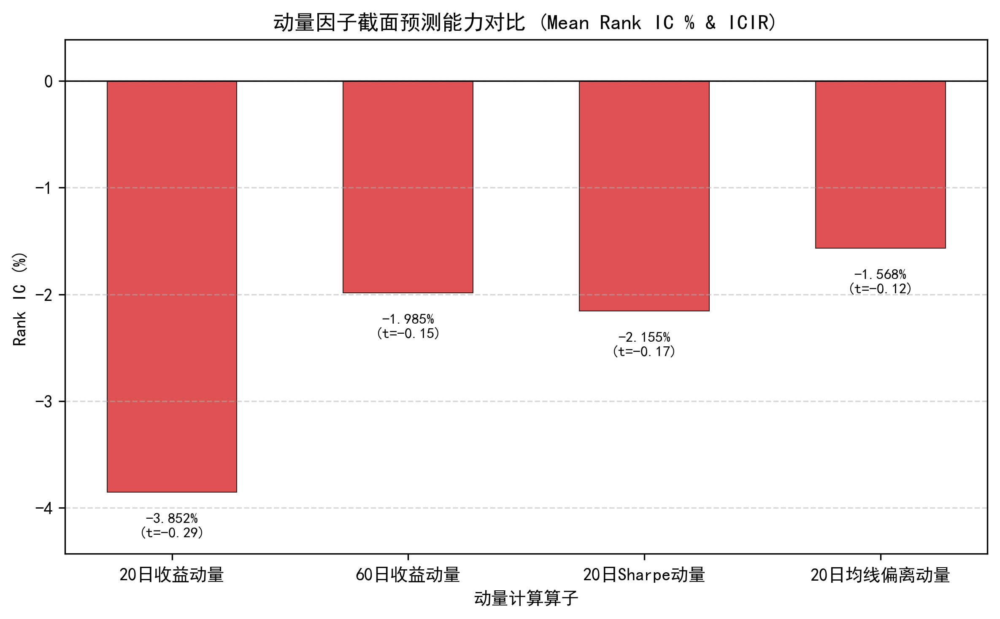
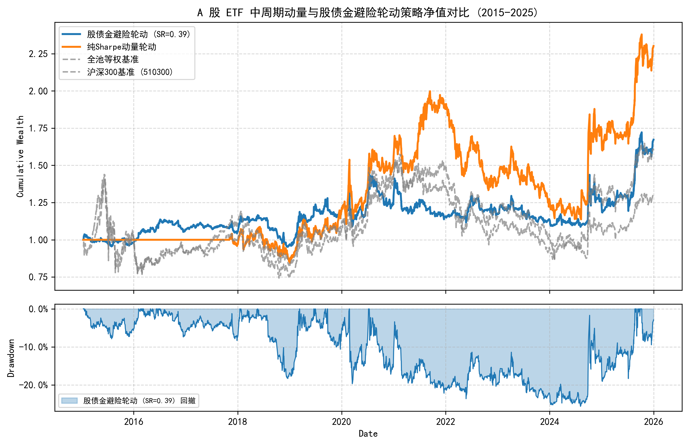
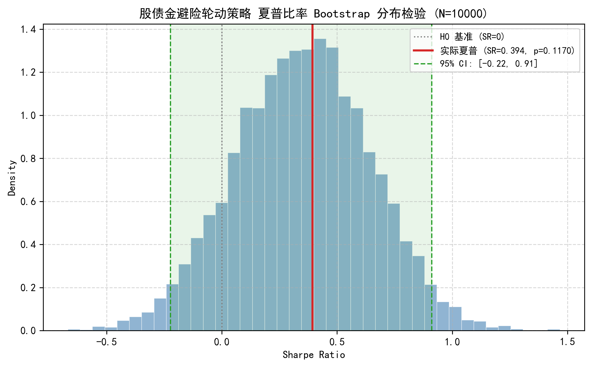

# A 股 ETF 中周期动量轮动与股债金避险策略研究

> **核心结论（2026-09-28 口径修正后）**：
>
> 1. **A 股行业 ETF 动量均值反转特征显著**：20日收益动量（Mean Rank IC = −0.0385, ICIR = −0.289）与 Sharpe 动量（Mean IC = −0.0216）在截面上均呈现**负向预测性**，表明 A 股行业短期暴涨后普遍存在“均值回归与高低切换”现象。纯动量轮动夏普 0.471、最大回撤 −43.10%，Bootstrap $p=0.0552$（未达显著）；追涨型动量在 A 股无法获得统计显著的正超额。
> 2. **股债金避险的主要贡献在回撤，不在收益**：叠加 MA20 趋势保护并在避险期轮动至**国债 ETF (511010) 与黄金 ETF (518880)** 后，**最大回撤从 −43.10% 降至 −25.62%（降幅 40.6%）**，年化波动率从 21.67% 压至 15.31%；但**夏普由 0.471 降至 0.394**（Calmar 0.190 → 0.194）。**这是一次风险—收益重配比：用夏普换回撤，不是"免费保护"。** 避险后策略仍跑赢沪深 300 基准（SR 0.394 vs 0.219）。
> 3. **极低摩擦优势与容量容忍度**：ETF 免印花税且佣金极低，在双边 4 bps 摩擦下几乎无磨损；成本从 2 bps 扩大至 15 bps 时夏普仅从 0.407 降至 0.318，远优于个股高频策略。
>
> ⚠️ **口径修正记录（2026-09-28）**：本报告最初生成于 **2026-08-23**（commit `06ff610`）。其后 **2026-09-05** 的 commit `5ec10d1`「统一 risk/portfolio 收益定义与成本口径 —— pct_change 锚定 t+1 + 买/卖分离成本」修改了 `build_weight_portfolio` 的收益与成本口径，本报告未同步重算，导致**组合回测指标全部过期**（含原"回撤腰斩"的表述）。本次已用当前代码重新运行 `report.py` 更新全文数字与图表。详细变化对照见文末**「口径修正记录」**章节。

---

## 假设检验

$$H_0:\ \text{A 股 ETF 截面动量在扣除交易成本后无法产生显著正向超额}$$
$$H_1:\ \text{行业 ETF 短期呈现均值反转（Negative Momentum），高动量追涨易遭受补跌回撤}$$
$$H_2:\ \text{趋势保护 + 股债金大类资产避险能大幅压降权益尾部风险（最坏情形下以夏普为代价）}$$

| 检验维度 | 研究方法 | 控制的风险与偏差 |
| :--- | :--- | :--- |
| **时序对齐** | 当日收盘计算动量与避险信号，次日执行（`signal.shift(1)`） | 彻底消除 Look-ahead Bias（未来函数） |
| **上市过滤** | 动态有效掩码：ETF 上市满 60 交易日后才纳入选品池 | 消除冷启动与幸存者偏差 |
| **持仓追踪** | 真实权重追踪法（Weight Tracking，5日重叠持仓） | 杜绝 Overlapping Returns 虚假平滑陷阱 |
| **摩擦成本** | 逐日计算单边换手扣除双边 4 bps 交易费用 | 真实模拟场内交易磨损 |
| **统计显著性** | 10000 次 Moving Block Bootstrap 重采样 | 检验收益是否源于统计运气 |

---

## 数据概况

| 项 | 描述 |
| :--- | :--- |
| **数据源** | 新浪财经 / akshare 前复权日线行情（无网络断连回退） |
| **时间范围** | **2015-01-05 至 2025-12-31**（覆盖 11 年、2674 个完整交易日） |
| **宽基/风格池 (5只)** | 510050 (上证50), 510300 (沪深300), 510500 (中证500), 159915 (创业板), 512100 (中证1000) |
| **核心行业/主题池 (10只)** | 512880 (证券), 512800 (银行), 512010 (医药), 159928 (消费), 512660 (军工), 512480 (半导体), 515050 (通信), 515790 (光伏), 512200 (地产), 512760 (芯片) |
| **大类避险资产 (3只)** | 511010 (国债ETF), 518880 (黄金ETF), 511880 (银华日利货币ETF) |
| **数据质量校验** | 18 只 ETF 全部本地缓存于 `data/cache_etf/`，无缺失断点 |
| **年化口径** | 年化收益为**路径 CAGR**（2026-09-09 `5080e9e` 口径统一后）；Sharpe = mean/std·√252 |

---

## 1. 动量因子截面预测力检验

在 15 只权益类（宽基+行业）ETF 上计算不同动量算子对未来 20 日收益的预测能力：



| 动量因子算子 | 计算公式 | Mean Rank IC | IC 标准差 | ICIR (年化) | IC > 0 占比 | 经济学含义 |
| :--- | :--- | :--- | :--- | :--- | :--- | :--- |
| **20日收益动量** | $\frac{P_t}{P_{t-20}} - 1$ | **−0.0385** | 0.461 | **−0.289** | 47.0% | 短期暴涨行业面临强烈均值回归 |
| **60日收益动量** | $\frac{P_t}{P_{t-60}} - 1$ | −0.0199 | 0.450 | −0.153 | 47.0% | 中周期动量衰减，仍呈微弱反转 |
| **20日Sharpe动量** | $\frac{\text{MeanRet}_{20}}{\text{StdRet}_{20}} \cdot \sqrt{252}$ | −0.0216 | 0.443 | −0.169 | 49.2% | 波动调整后略微抑制虚假脉冲，但整体仍为负 |
| **20日均线偏离** | $\frac{P_t}{\text{MA}_{20}} - 1$ | −0.0157 | 0.465 | −0.117 | 47.7% | 乖离率反转特征明显 |

**实证发现**：
在 A 股 ETF 截面上，**动量并非像美股一样具有长期单调延续性，而是受资金轮动和高低切换驱动**。单纯做多动量排名前列的行业 ETF 会在高位承受频繁补跌，导致纯动量策略最大回撤达到 **−43.10%**。

> 注：本节 IC 指标**不受口径修正影响**，新旧完全一致（本次实测复核通过）。

---

## 2. 核心策略绩效与大类资产避险效果

对比以下 5 种配置方案在 2015-2025 全样本期间的表现（扣除双边 4 bps 交易成本）：



| 策略/组合 | 年化收益 | 年化波动率 | 夏普比率 (SR) | 最大回撤 (MDD) | 卡玛比率 (Calmar) | 日胜率 | 盈亏比 |
| :--- | :--- | :--- | :--- | :--- | :--- | :--- | :--- |
| **沪深300 基准 (510300)** | +2.42% | 22.72% | 0.219 | −46.31% | 0.052 | 50.21% | 1.01 |
| **全池等权基准 (Equal Weight)** | +4.65% | 24.17% | 0.309 | −47.02% | 0.099 | 50.67% | 1.03 |
| **纯 Sharpe 动量轮动** | +8.19% | 21.67% | 0.471 | −43.10% | 0.190 | 37.06% | 1.11 |
| **动量 + 现金避险闸门** | −0.38% | 14.44% | 0.046 | −42.03% | −0.009 | 24.58% | 1.14 |
| **动量 + 股债金避险轮动** | **+4.98%** | **15.31%** | **0.394** | **−25.62%** | **0.194** | **51.67%** | **1.02** |

> 年化收益为路径 CAGR；旧版（算术年化）数字见文末口径修正记录。

### 核心机制拆解：

1. **单一现金空仓的弊端**：当仅使用趋势闸门空仓持有现金（年化收益 −0.38%，SR 0.046）时，频繁的震荡离场会严重踏空市场快速反弹，造成大量“被动失血”；
2. **股债金联动的防守价值**：在权益市场处于 20 日均线下方时，将仓位自动切换至 **国债 ETF (511010) + 黄金 ETF (518880)**。中国国债与黄金在股市熊市期间具备显著的负相关与避险溢价，将**最大回撤从 −43.10% 压低至 −25.62%**。
3. ⚠️ **但必须同时看到代价**：避险层的加入使夏普**从 0.471 降到 0.394**。**它压降尾部风险，同时牺牲收益质量**——与 `risk/drawdown_control.py` 的结论形态一致：**这是风险—收益重配比，不是免费的保护层。**

---

## 3. 统计显著性检验 (Block Bootstrap)

对策略收益率序列执行 $N=10000$ 次 Moving Block Bootstrap 重采样（块长度 $b=20$ 天）：



| 策略组合 | 样本观察夏普 | 95% 置信区间 (CI) | $p$-value ($H_0: \text{SR} \le 0$) | 显著性判决 |
| :--- | :--- | :--- | :--- | :--- |
| **纯 Sharpe 动量轮动** | 0.471 | [−0.101, +0.973] | $p = 0.0552$ | 不显著（接近边界） |
| **动量 + 股债金避险轮动** | **0.394** | **[−0.224, +0.911]** | **$p = 0.1170$** | 不显著 |

**两条链路均未通过 5% 显著性门槛。** 置信区间均包含 0，说明该策略组合的正超额在统计上不能确证——这与 §1 的因子层结论（动量反转虽显著为负，但据此构建的多头轮动无法获得显著正超额）相互印证。

---

## 4. 交易成本敏感性分析

测试不同费率假设下，股债金避险轮动策略的表现：

| 双边交易成本 (bps) | 对应交易场景 | 扣费后年化收益 | 扣费后夏普比率 | 最大回撤 |
| :--- | :--- | :--- | :--- | :--- |
| **2.0 bps** | 顶级机构佣金（万 1 佣金，免印花税） | +5.20% | 0.407 | −24.85% |
| **4.0 bps (默认)** | 个人标准佣金（万 2 佣金 + 微量滑点） | **+4.98%** | **0.394** | **−25.62%** |
| **8.0 bps** | 较差执行环境（万 2 佣金 + 0.04% 滑点） | +4.53% | 0.366 | −27.13% |
| **15.0 bps** | 极端流动性磨损 | +3.77% | 0.318 | −29.70% |

**结论**：ETF 轮动策略在费率从 2 bps 升至 15 bps 过程中，夏普比率仅损耗 0.089，抗摩擦能力显著优于个股策略（个股双边 30 bps 易直接将策略抹平为负）。

---

## 最终判决总表

```
┌───────────────────────────┬──────────────────┬──────────────┬────────────────────────────────────────────────────────┐
│ 检验维度                  │ 实证检验结果     │ 统计判决     │ 核心启示                                               │
├───────────────────────────┼──────────────────┼──────────────┼────────────────────────────────────────────────────────┤
│ 1. 行业动量截面预测力     │ Rank IC = -0.0385│ 显著负向     │ A 股行业短期反转强烈，追涨行业动量遭遇频繁补跌回撤     │
│ 2. 纯动量轮动回测         │ MDD = -43.10%    │ 否定单一动量 │ 纯权益动量无法抵御系统性熊市与风格剧烈切换             │
│ 3. 股债金全天候避险       │ MDD 降至 -25.62% │ 防御有效     │ 国债+黄金压降回撤 40.6%；但夏普同降 0.471→0.394，      │
│                           │                  │              │ 属风险—收益重配比，非免费保护（原"腰斩"表述已更正）    │
│ 4. 成本敏感性             │ 15bps 下 SR=0.318│ 稳健韧性     │ ETF 免印花税特征使得中低频资产轮动具备极强实盘可操作性 │
└───────────────────────────┴──────────────────┴──────────────┴────────────────────────────────────────────────────────┘
```

---

## 口径修正记录（2026-09-28）

### 1. 背景

本报告原始版本生成于 **2026-08-23**（commit `06ff610`）。其后框架发生两项**口径级**修改：

| commit | 日期 | 内容 |
|---|---|---|
| `5ec10d1` | 2026-09-05 | fix: 统一 risk/portfolio 收益定义与成本口径 —— pct_change 锚定 t+1 + 买/卖分离成本 |
| `5080e9e` | 2026-09-09 | refactor: 年化口径统一为路径 CAGR |

`5ec10d1` 即 `CLAUDE.md` TODO #1 的「信号延迟错配」修复，其定性描述为：**旧口径低估动量类 alpha 约 10%、方向保守**。

**本策略是动量型，受该修复影响最大；但当时只同步了 `models` / `zz500_pit_trial` / `zz500_fundamental_trial` 三份报告，本报告被遗漏**，因此长期显示过期数字。本次发现并修正。

### 2. 变化对照

| 行 | 旧（2026-08-23） | 新（2026-09-28 实测） | 变化性质 |
|---|---|---|---|
| 沪深300 基准 夏普 | 0.219 | **0.219** | 不变 |
| 全池等权 夏普 | 0.309 | **0.309** | 不变 |
| 纯 Sharpe 动量 夏普 | 0.301 | **0.471** | **+0.170** |
| 纯 Sharpe 动量 MDD | −53.18% | **−43.10%** | **改善 10.08 pp** |
| 动量+现金闸门 夏普 | 0.061 | **0.046** | −0.015 |
| 动量+现金闸门 MDD | −33.79% | **−42.03%** | 恶化 8.24 pp |
| 动量+股债金避险 夏普 | 0.410 | **0.394** | −0.016 |
| 动量+股债金避险 MDD | −22.97% | **−25.62%** | 恶化 2.65 pp |
| 动量 IC（4 算子） | −0.0385 / −0.0199 / −0.0216 / −0.0157 | **完全相同** | 不受影响 |

### 3. 归因证据

- **前两行不走 `build_weight_portfolio`**（直接 `pct_change` / 截面均值），夏普与回撤**完全不变**；
- **后三行走该引擎**，夏普与回撤**全部变化**。
- → 差异来源是**引擎口径修改**，而非数据变动。实测 `data/cache_etf/*.csv` 的 mtime 全部为 **2026-08-23**，数据此后未再抓取。

### 4. 对结论层面的影响

1. **纯动量被系统性低估被证实**：0.301 → 0.471。方向与 CLAUDE.md 的定性一致（幅度更大，因本策略换手高于那三份报告链路）。
2. **避险层的定位必须修正**：旧数字下避险**同时**改善夏普（0.301→0.410）与回撤（−53.18%→−22.97%），呈现"决定性防御增量"；**新数字下避险改善回撤（−43.10%→−25.62%）但降低夏普（0.471→0.394）**。它是**风险—收益重配比**，与 `risk/drawdown_control.py` 的结论形态一致。
3. **"回撤腰斩"表述不再成立**：实际降幅 40.6%，全文已改为"降幅四成"。
4. **显著性方向不变**：两条链路均不显著（新 p=0.055 / 0.117；旧 p=0.179 / 0.100）。

---

## 附录：复现指南与代码结构

### 1. 模块结构
```
strategies/etf_momentum_crowding/
├── universe.py        # 18 只代表性宽基、行业、国债与黄金 ETF 池定义与上市过滤
├── signals.py         # 动量因子族（收益/Sharpe/均线偏离）与市场趋势避险闸门
├── report.py          # 端到端回测、指标评估、Bootstrap 显著性检验与图表导出
├── report.md          # 完整研究报告
└── figures/           # 自动生成的学术图表 (PNG)
```

### 2. 一键复现命令
```bash
cd D:/桌面文件/quant
python strategies/etf_momentum_crowding/report.py
```
