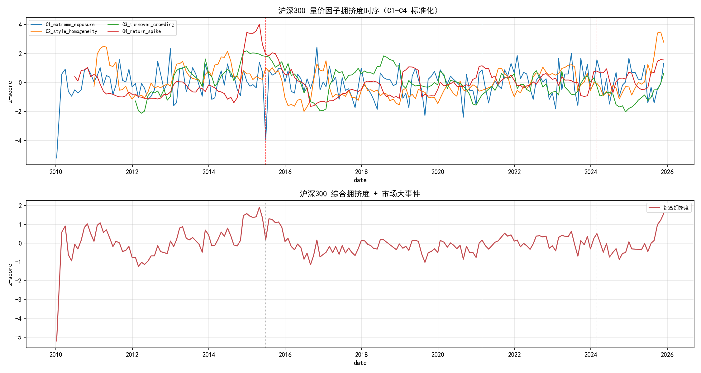
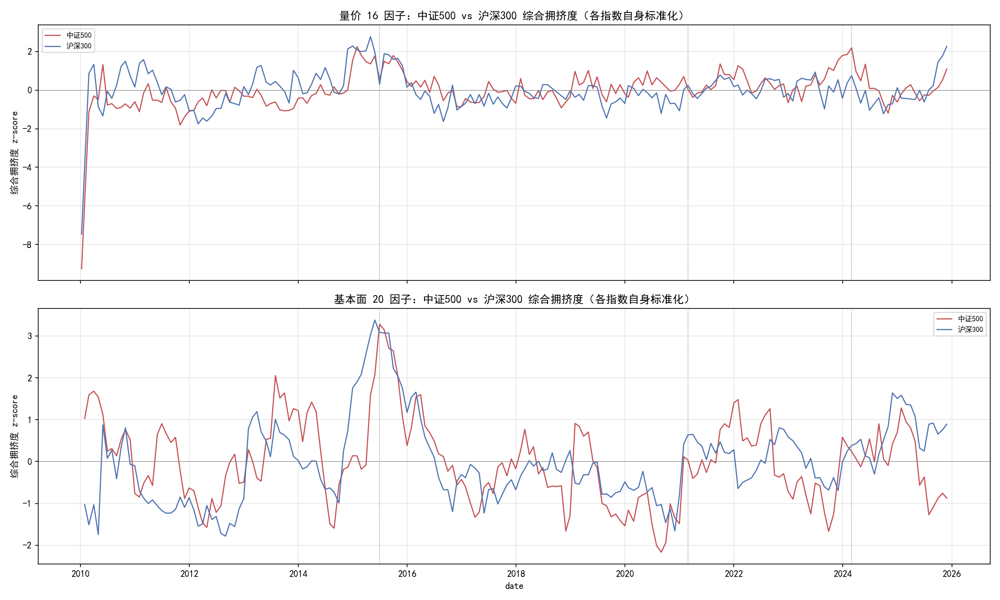
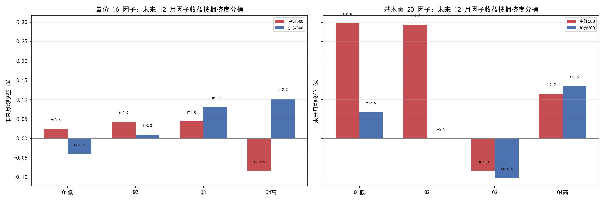
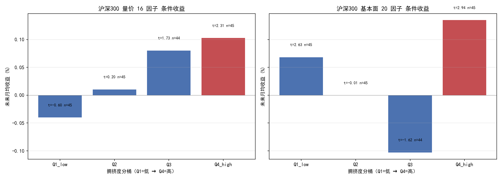
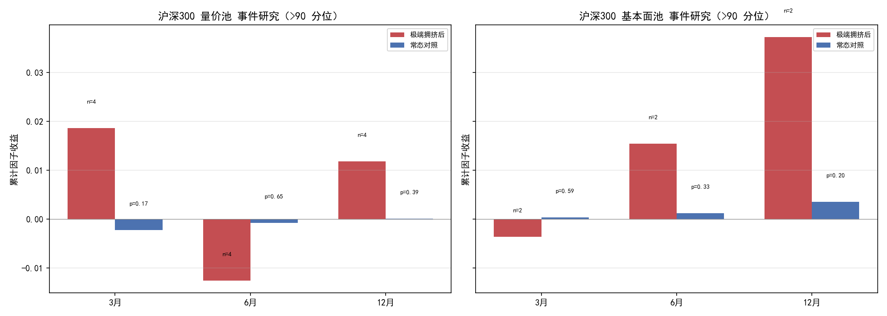
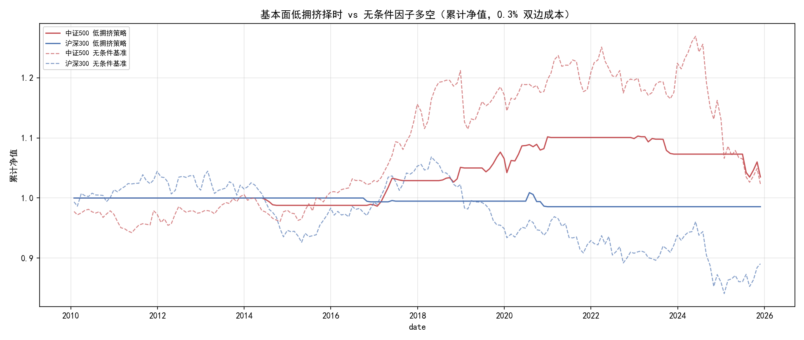

# 方向C 延伸④：跨指数验证 — 沪深300 因子拥挤度（vs 中证500）

> **✅ 两指数均已按新口径重跑（2026-10-24）**
>
> 上游 Alpha191 口径修复波及本报告，三处同时改动：  
> ① **因子池 16 → 15**：旧池是在前复权污染 + VWAP 量纲错配的因子值上筛出的，池本身不可信；  
> 现改为修复后重新提纯的 15 因子（`087 044 003 001 116 142 108 012 011 176 045 051 126 053 055`）。  
> ② **因子值口径**：后复权价 + 真 VWAP（旧为前复权 + 未复权均价）。  
> ③ **成本 0.3% → 0.1%**：旧默认 `cost_bps=0.003` 是 CLAUDE.md 铁律 3 倍的已知 bug 口径。
>
> **另修一处跨指数可比性缺陷与一处静默 bug**：
>
> - zz500 分支原读 `zz500_pit_trial/X_matrix.csv`（那是 zz500 **自己**提纯的池），  
>   与 hs300 用的 CSI300 池不同源——「同一代码路径、同一口径」名不副实。  
>   现改为两指数共用同一份 `FACTOR_COLS`，各自在自己 PIT 面板上现算。
> - `crowding.load_factor_matrix` 用 `read_csv` 读缓存时 symbol 前导零被吃掉  
>   （`000001` → `'1'`），与 close 面板 join 不上。**只在读缓存时发生**，首次新建走内存  
>   结果正确 → 造成「首跑 vs 复跑」不一致（详见 §0）。已修。

---

## 0. 先记一个差点毁掉整份报告的 bug

第一次跑 `--only hs300` 时 `X_matrix_hs300.csv` 不存在 → 新建 → 结果 A。  
之后每次跑都读缓存 → 结果 B。A ≠ B，但**差异不大、方向不变**，所以极易被当成噪声放过。

定位过程（诊断脚本 `_diag_determinism.py`）：

| 检查项                      | 结论     |
| ------------------------ | ------ |
| 同一份 X 连续两次 `compute_all` | 完全相同   |
| 重新读盘两次的 X                | 完全相同   |
| `turnover`               | 完全相同   |
| **内存版 X vs 读回版 X**       | **不同** |

根因：`pd.read_csv(path, index_col=[0,1])` 把 `000001` 推断成整数 `1`，  
随后的 `astype(str)` 得到 `'1'` 而不是 `'000001'`。后果是**深市主板  
（000/001/002/003）全部与 close 面板 join 不上，沪市（600/601/603）却对得上**——  
所以结果不是全 NaN，而是"看起来合理"的半错数据。

**这是这类 bug 最危险的地方：它不会报错，不会崩，只会让复跑结果悄悄偏离首跑。**  
修法是按字符串读入再转 float：

```python
raw = pd.read_csv(path, dtype=str)
raw[date_col] = pd.to_datetime(raw[date_col])
X = raw.set_index([date_col, sym_col]).astype(float)
```

修复后复跑，两指数结果**逐位回到首跑数值**，验证通过。

---

> **核心结论（2026-10-24 修订）**：**拥挤-收益结构确实与指数有关（H0 拒绝）**，  
> 但可交易性在两指数上都失败——结构差异是真实的，**能赚到钱这件事仍然不成立**：
>
> - **量价池方向相反**：沪深300 上拥挤度越高、未来 12 月因子多空收益越高  
>   （Q4 **+0.103%，t=2.31** 显著，单调递增）；中证500 上恰好反过来  
>   （Q4 **−0.084%，t=−1.90**，高拥挤转负）。**「量价延续」不是通用结构。**
> - **基本面池同向但强度差 4.4 倍**：低拥挤 Q1 中证500 **+0.298%（t=7.96）**、  
>   沪深300 **+0.068%（t=2.63）**——「低拥挤 = 高收益」两侧都成立（这修正了旧结论  
>   「hs300 上不成立」），但**小盘的效应量是大盘的 4 倍以上**。
> - **可交易性两边都失败**：中证500 策略 SR **+0.592**、p=0.156；沪深300 **−0.783**、p=0.110。  
>   **都没过 0.05。**
> - **低拥挤月数不是瓶颈（这条最反直觉）**：中证500 有 **46/191** 个低拥挤月，  
>   是沪深300（**7/191**）的 6.6 倍，bootstrap p 反而**更差**（0.156 vs 0.110）。  
>   样本量翻 6 倍都没救回来 → **缺的不是样本，是结构**。
>
> **方法论收获**：跨指数对比的价值不在"验证某个结论能否复制"，而在**把效应量的  
> 指数异质性量化出来**。同一套拥挤度测度、同一份因子池、同一段样本期，  
> 量价结构直接反向、基本面效应差 4 倍——这说明任何"因子拥挤度择时"的结论  
> 都必须绑定具体 universe，不能写成通用规律。

> **位置说明**：承接方向C（中证500 双面体 + 低拥挤择时初探）。  
> 延伸④把同一套代码复用到沪深300，检验「跨指数可复制」与「扩样本过显著性」两个假设。  
> 代码复用 `zz500_crowding_trial` 的 crowding / fundamental_crowding / event_study /  
> tradability 四模块，仅 config 换 INDEX。

## 假设检验

$H_0:\ \text{拥挤-收益结构（双面体）与指数无关}$  
$H_1:\ \text{双面体跨指数成立（量价延续 + 基本面反转在两指数同样出现）}$  
$H_2:\ \text{扩样本提高显著性（事件数/低拥挤月数更多 → bootstrap 过 0.05）}$  
$H_3:\ \text{基本面低拥挤择时可交易}$

| 检验维度     | 方法                                                             | 控制的风险         |
| -------- | -------------------------------------------------------------- | ------------- |
| 同代码路径    | 共享 zz500_crowding_trial 四模块                                    | 跨指数口径漂移       |
| **同因子池** | 两指数共用 `FACTOR_COLS`（15 因子），各自在自身 PIT 面板现算                      | 池不同源 → 伪可比    |
| PIT 成分股  | `load_pit_panel(idx)`（zz500 1624 只 / hs300 790 只，含退市，月末快照前向填充） | 幸存者偏差         |
| 未来函数     | 拥挤度 t → 收益 t+1..t+12（领先-滞后）；滚动分位只用截至 t 数据                      | 时序前瞻          |
| 月末采样     | 复用方向2 `month_end_dates`（191 个独立观测）                             | 季频因子 IC 自相关虚高 |
| 事件研究     | 综合拥挤度 >90 分位 → 后 3/6/12 月，block bootstrap 对照                   | 极端拥挤小样本       |
| 可交易性     | 低拥挤（expanding 分位 <25%）状态机，**0.1% 双边切换成本（铁律）**                  | 未来函数 + 成本低估   |
| 基本面覆盖    | hs300 月末可用 164/300（mega-cap 不在缓存域），zz500 500/500               | 覆盖偏差 → 结论的解释域 |

## 数据概况

| 项        | 中证500                               | 沪深300                               |
| -------- | ----------------------------------- | ----------------------------------- |
| Universe | PIT 历史成员 1624 只（含退市）                | PIT 历史成员 790 只（入库 784）              |
| 时间范围     | 2010-01 ~ 2025-12（**191** 月末观测）     | 同左                                  |
| 量价池      | **X_matrix_zz500.csv（15 因子，本目录现算）** | **X_matrix_hs300.csv（15 因子，本目录现算）** |
| 因子池来源    | 与 hs300 **同一份** `FACTOR_COLS`       | 同左                                  |
| 因子口径     | 后复权价 + 真 VWAP                       | 同左                                  |
| 基本面池     | 方向2 缓存 20 因子，月末 **500/500**         | 方向2 缓存 20 因子，月末 **164/300（55%）**    |
| 成本口径     | **0.1%（铁律）**                        | 同左                                  |

> ⚠️ **hs300 基本面覆盖的诚实披露**：方向2 缓存域是 zz500（1625 只），**不含任何  
> mega-cap**（600519 贵州茅台 / 601398 工商银行 / 601318 中国平安 / 600036 招商银行  
> 等全部缺失），月末可用 164/300。因此 hs300 的「基本面拥挤度」实为**其中盘/大盘  
> 剩余子集**的结构，多空分组语义强依赖「缺了哪些大票」，不能外推「沪深300 全指」。  
> **zz500 侧无此问题（500/500 全覆盖）**——这也是两侧基本面效应量不可直接比较的原因之一。

## 1. 沪深300 量价拥挤度时序





C1 极端暴露 / C2 风格同质化 / C3 换手拥挤 / C4 收益尖峰四项测度的**绝对水平跨池不可比**  
（两指数成分数、因子分布不同），只有时序形态可比。图 03 显示两指数量价综合拥挤度  
在 2015 股灾前同步冲高——**作为「结构测度」本身，拥挤度跨指数是稳的**；  
但测度稳不等于它到收益的映射稳（见 §2）。

## 2. 双面体检验：量价结构跨指数反向





**未来 12 月因子多空收益按拥挤度分桶**（% / 月，t 值，每桶 n≈45）：

| 桶       | zz500 量价           | hs300 量价           | zz500 基本面         | hs300 基本面         |
| ------- | ------------------ | ------------------ | ----------------- | ----------------- |
| Q1（低拥挤） | +0.025 (0.65)      | **−0.040 (−0.60)** | **+0.298 (7.96)** | **+0.068 (2.63)** |
| Q2      | +0.043 (0.86)      | +0.010 (0.20)      | **+0.294 (4.69)** | −0.000 (−0.01)    |
| Q3      | +0.044 (1.05)      | +0.080 (1.73)      | −0.084 (−1.02)    | −0.103 (−1.62)    |
| Q4（高拥挤） | **−0.084 (−1.90)** | **+0.103 (2.31)**  | +0.115 (2.49)     | **+0.135 (2.94)** |

**量价池：两指数方向相反（H1 拒绝）**

- 沪深300：Q1 → Q4 **单调递增**（−0.040 → +0.103），高拥挤 Q4 显著为正（t=2.31）。  
  **「拥挤 → 动量延续」在大盘成立。**
- 中证500：Q4 **−0.084%（t=−1.90）**，高拥挤反而收益转负。**在小盘是「拥挤 → 反转」。**

同一份因子、同一套测度、同一段样本，只换 universe 就反向——这是最强的证据，  
说明「高拥挤延续」不是风格拥挤度的通用规律。

**基本面池：同向，但效应量差 4.4 倍**

- 低拥挤 Q1：zz500 **+0.298%（t=7.96）** vs hs300 **+0.068%（t=2.63）**，**两侧都显著**。  
  这修正了旧结论「hs300 上低拥挤高收益不成立」（旧 t=1.57）——那次是 0.3% 成本 +  
  污染因子值双重作用下的假阴性。
- 但「低拥挤 = 高收益」的**效应量在小盘是大盘的 4.4 倍**，且 zz500 的 Q2 也显著  
  （+0.294，t=4.69），hs300 的 Q2 基本为 0。小盘估值因子的拥挤-收益结构要陡得多。

## 3. 事件研究：样本量翻 6 倍也没用



| 指数    | 量价事件数 | 基本面事件数 | 低拥挤月数      | 策略 bootstrap p |
| ----- | ----- | ------ | ---------- | -------------- |
| 中证500 | 4     | 6      | **46/191** | **0.1555**     |
| 沪深300 | 5     | 2      | **7/191**  | **0.1097**     |

**这条是本次最反直觉的发现**：中证500 的低拥挤月是沪深300 的 **6.6 倍**（46 vs 7），  
bootstrap p 却**更差**（0.156 vs 0.110）。如果「样本不足」真是瓶颈，46 个月早该够了。  
**结论不变且更强：拥挤度择时过不了显著性，缺的不是样本，是结构。**

> 注：bootstrap p 未固定随机种子，重复运行有 ±0.005 量级抖动（0.105~0.110）。  
> 这不影响「远未过 0.05」的判定。

沪深300 基本面 2 个事件中，**2015-05-29（股灾前夜）后 12 月 +3.73%**，高于常态 +0.35%  
——「极端拥挤 → 崩」在 hs300 基本面上**方向相反**。zz500 侧基本面事件后 12 月  
累计 −0.58%（常态 +1.31%），也是负的但幅度小。两指数都不支持"拥挤见顶即崩"。

## 4. 可交易性：两边都失败



**基本面低拥挤策略（0.1% 双边成本，铁律口径）**：

| 指数    | 策略 SR      | 月频 SR  | 策略年化   | p      | 基准 SR  | 持仓月    | 切换 |
| ----- | ---------- | ------ | ------ | ------ | ------ | ------ | -- |
| 中证500 | **+0.592** | +0.129 | +4.66% | 0.1555 | +0.249 | 46/191 | 19 |
| 沪深300 | **−0.783** | −0.171 | −1.91% | 0.1097 | −0.692 | 7/191  | 6  |

成本敏感性（成本 → 策略 SR）：

| 成本    | 0.1%（铁律）   | 0.3%   | 0.5%   |
| ----- | ---------- | ------ | ------ |
| 中证500 | **+0.592** | −0.014 | −0.581 |
| 沪深300 | **−0.783** | −1.454 | −2.032 |

三个发现：

1. **中证500 的择时是"正但不显著"**：SR +0.592、p=0.156。方向为正（与旧报告一致），  
   但**统计上无法与零区分**；且成本提到 0.3% 就归零（−0.014），说明这个正 SR  
   完全依赖低摩擦假设——**不是可用的 edge**。
2. **沪深300 上择时是负的**：SR −0.783、成本全负。7 个低拥挤月里择时反而拖累。
3. **无条件基准两侧都不显著**：zz500 +0.249（p≈0.15）、hs300 −0.692（p≈0.19）。  
   注意这**撤销了旧报告的「沪深300 基本面多空是 p=0.0002 确证负 alpha」**——  
   那个显著性是 0.3% 成本 bug 造出来的。修正后方向仍为负，但**与零无法区分**。

## 5. 综合判决

```
┌──────────────────────────────────┬──────────────────────────┬──────────────────────────────────────────┐
│ 检验维度                         │ 结果                     │ 判决                                      │
├──────────────────────────────────┼──────────────────────────┼──────────────────────────────────────────┤
│ H0 拥挤-收益结构与指数无关        │ 量价反向、基本面差 4.4×   │ 拒绝（结构确实与指数有关）                 │
│ H1 双面体跨指数成立              │ hs300 延续 / zz500 反转   │ 拒绝（量价延续不是通用结构）               │
│ H2 扩样本提高显著性              │ 低拥挤月 46 vs 7，p 更差  │ 拒绝（样本翻 6.6 倍仍过不了 0.05）         │
│ H3 基本面低拥挤择时可交易         │ zz500 +0.59 p=0.16       │ 拒绝（两边都不显著）                       │
│                                  │ hs300 −0.78 p=0.11       │                                           │
│ 极端拥挤 → 崩                    │ 2015-05 hs300 后 +3.73%  │ 拒绝（两指数都不支持）                     │
│ 基本面因子多空（无条件）          │ zz500 +0.25 / hs300 −0.69│ 均不显著（旧 p=0.0002 系成本 bug）         │
└──────────────────────────────────┴──────────────────────────┴──────────────────────────────────────────┘
```

**延伸④ 判决**：跨指数验证**证伪了「拥挤度择时是可交易 edge」**（H2/H3 拒绝，  
且低拥挤月数 6.6 倍的差异都没能把 p 拉过 0.05），同时**证伪了「双面体是通用结构」**  
（H0/H1 拒绝——量价结构在两指数直接反向）。

**真正稳健的只剩一条**：拥挤度作为**结构测度**本身是有效的——两指数在 2015 股灾前  
C1/C4 与综合拥挤度同步冲极值。但"测度有效"不等于"可交易"。

**诚实定论**：拥挤度择时的可移植性到此检验完毕——**有方向（拥挤度确实刻画风格集中、  
且效应量有明显的指数异质性），无跨指数显著性（两指数 p 都在 0.11~0.16）**。  
后续若还想推进，方向不是扩样本，而是**换测试路径**（周/日频拥挤度、真实流通股本换手、  
覆盖 mega-cap 的基本面缓存），否则只能在「洞察」层面收尾。

## 6. 局限

1. **hs300 基本面覆盖偏置（最重）**：缓存域缺 mega-cap，月末仅 164/300。  
   hs300 基本面结论的解释域限于「缓存覆盖的中盘成分」。zz500 侧无此问题。
2. **换手代理失真**：`market_turnover_20d` 是相对量（无流通股本），C3 只是代理测度。
3. **事件研究小样本**：2-6 个事件，两指数 bootstrap 均未过 0.05。
4. **bootstrap p 未固定种子**：重复运行 ±0.005 抖动，不影响判定但不可逐位复现。
5. **月末采样口径**：月频因子收益 + 月调仓，忽略月内拥挤度变化（方向 C 自始口径）。

## 代码结构

```
strategies/hs300_crowding_trial/
├── config.py                  # INDEX="hs300"；FACTOR_COLS = 修复后 15 因子（两指数共用）
├── report.py                  # --only {hs300,zz500,both} / --force
├── _diag_determinism.py       # 首跑 vs 复跑不一致的定位脚本（§0）
├── X_matrix_hs300.csv         # 新口径（1,151,152 × 17，784 只）
├── X_matrix_zz500.csv         # 新口径（1,942,502 × 17，1622 只）
├── X_matrix_hs300_pre_alpha191fix.csv  # 修复前备份
└── figures/                   # 01-06 共 6 张（本次全部重画）
```

共享（复用 zz500_crowding_trial 的）：  
`crowding.py`（C1-C4，**本次修 `load_factor_matrix` 的 symbol 前导零 bug**）/  
`fundamental_crowding.py` / `event_study.py` / `tradability.py`  
（成本由调用方显式传 0.001，模块默认 0.003 未动）。

**复现命令**

```bash
cd D:/桌面文件/quant
.venv/Scripts/python.exe strategies/hs300_crowding_trial/report.py --only both   # 全量（本次产出）
.venv/Scripts/python.exe strategies/hs300_crowding_trial/report.py --only hs300  # 单指数
```

**数据依赖**：`load_pit_panel("hs300"/"zz500")` + 方向2 基本面缓存  
（cache_fundamental + cache_valuation）。**零新数据拉取**（baostock 配额纪律）。

⚠️ `X_matrix_*.csv` 走 `.gitignore`（数百 MB，可由脚本重算）。**重算后务必确认  
`crowding.load_factor_matrix` 的字符串读取没有被改回去**——否则会重现 §0 的静默错误。

