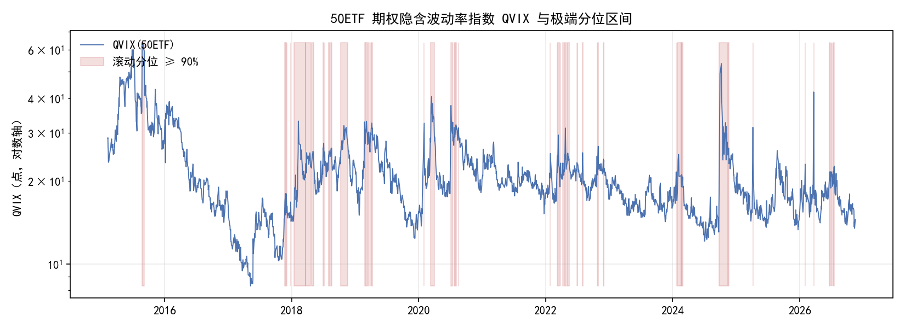
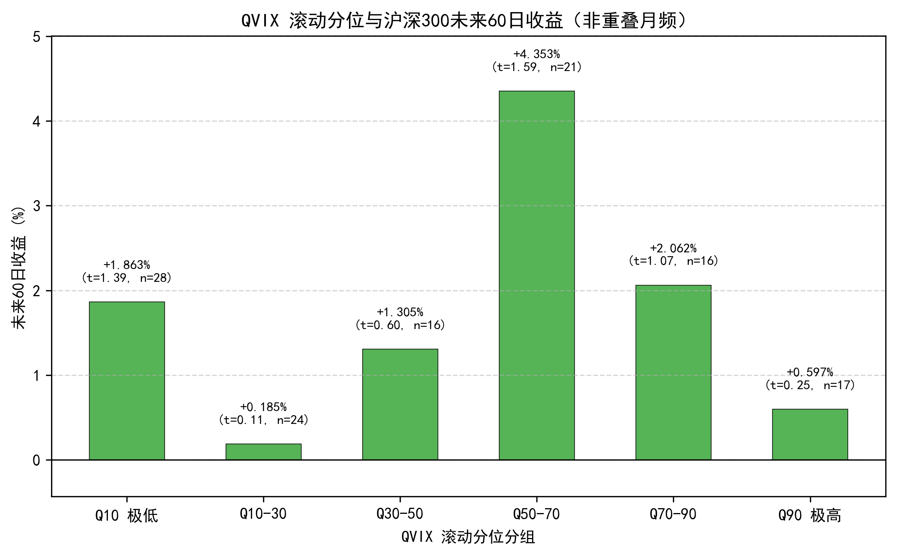
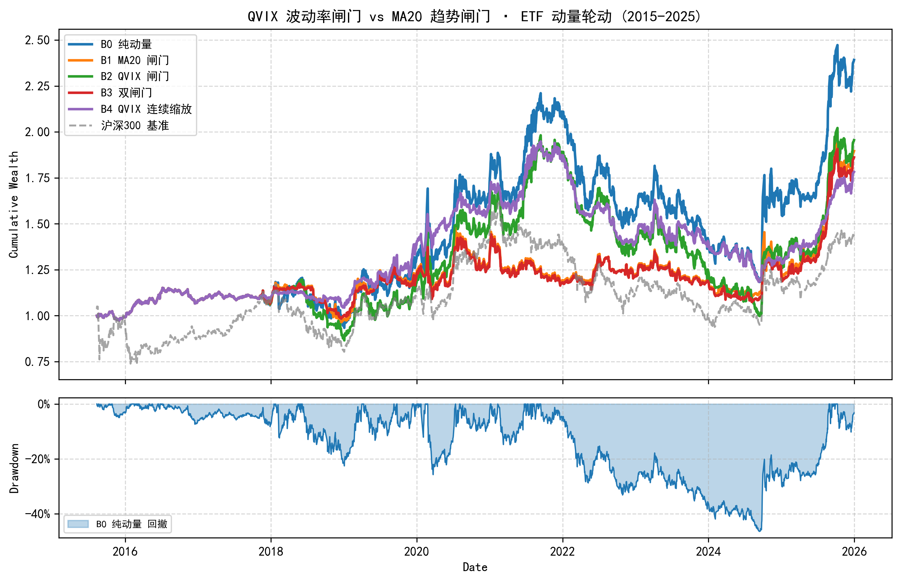

# QVIX 波动率状态闸门：能否改善 ETF 动量轮动？

> 研究日期：2026-11-18 ｜ 数据：QVIX(50ETF) 2015-02-09 ~ 2026-11-17，18 只 ETF 2015-01-05 ~ 2025-12-31（**后复权**）
> 复现：`cd strategies/qvix_regime && python report.py`

## 执行摘要

**把期权隐含波动率（QVIX）接成市场状态闸门，在同等平均权益暴露（38.9% vs 39.2%）下，夏普 0.665 vs 趋势闸门 MA20 的 0.492，年化 8.47% vs 6.59%。但代价是最大回撤从 −25.61% 恶化到 −40.49%，且优势极不稳健——2021 单年贡献了 146% 的年度夏普差，2022 年反向落后 3.25。**

四关判决 **2/4**：波动率预测能力（G2）与暴露匹配后的夏普（G4）通过；收益预测（G3）与逐年稳健性（G4c）未通过。

**结论：QVIX 不能替代 MA20，但双闸门并联有独立价值。** 组合 B3（MA20 与 QVIX 同时开仓才建仓）年化 6.40%、夏普 **0.529**、最大回撤 **−25.51%**——夏普高于纯动量（0.510），回撤仅为纯动量（−46.48%）的 55%。B4（连续仓位缩放）夏普 0.533 为全表最高，但回撤 −39.21% 明显劣于 B3。

## 1. 研究问题

`etf_momentum_crowding` 已证明：20 日 Sharpe 动量轮动叠加 MA20 趋势闸门，能把最大回撤从 −46.48% 压到 −25.61%，夏普由 0.459 升至 0.468（后复权口径）。本报告检验一个独立的第二闸门：**用期权隐含波动率（而非价格趋势）判断市场状态，能否以更小的收益代价换到同样的风险控制**。

| 假设 | $H_0$ | $H_1$ | 判据 |
|---|---|---|---|
| H1 数据可信 | QVIX 与标的已实现波动率无关 | 两者强正相关且存在方差风险溢价 | Pearson ≥ 0.60 且 $IV-RV$ 中位 > 0 |
| H2 波动预测 | QVIX 对 $RV_{t+20}$ 无增量信息 | 超越历史 RV 基准 | 联合回归 $t_{IV}>2$ 且 $R^2_{IV} > R^2_{RV}$ |
| H3 收益预测 | 极端 QVIX 分位的未来收益无差异 | 极端分位显著更低 | 置换检验 $p<0.10$ |
| H4 可交易 | 同等暴露下 QVIX 闸门不优于 MA20 | 夏普更高且 walk-forward 稳定 | 夏普差 > 0 **且** 胜出过半 **且** 无单年贡献 > 50% |

## 2. 数据

| 序列 | 来源 | 区间 | 样本 | 说明 |
|---|---|---|---|---|
| QVIX(50ETF) | 期权论坛 optbbs（**非官方**） | 2015-02-09 ~ 2026-11-17 | 2850 | 中证 iVIX 2018-02 停发后的业内替代口径 |
| 50ETF / 18 只 ETF | `data/cache_etf`（akshare 新浪源）+ **后复权** | 2015-01-05 ~ 2025-12-31 | 2674 | 分红 45 次、份额折算 8 处已修正 |
| 统一样本 | — | 2015-08-05 ~ 2025-12-31 | 2530 | QVIX 滚动分位预热完成后 |

**三处数据问题必须先处理**：

1. **QVIX 无历史期权链可自算**。`akshare.option_finance_board` 只返回当日快照，历史期权链接口在当前版本已失效；`baostock` 的 `adjustflag` 对 ETF 不生效。CBOE 算法在 A 股**无法低成本复原**，只能用第三方成品指数——这是本报告必须做 G1 审计的原因。
2. **ETF 原始缓存未复权**（2026-11-18 修复）。`etf_fetcher` 原实现调用 `fund_etf_hist_sina`（无复权参数）却声称"前复权"。实测 6 处份额折算（幅度 53%~249%）与 45 次分红未计入，其中 510500 单处折算使年化虚高 12.6pp。现已由 `data/etf_adjust.py` 构造后复权因子并作为数据层默认口径（详见 §6.7）。
3. **对照组样本起点不统一**。QVIX 的 252 日分位预热使 2015 年股灾整段落在「分位为 NaN → 默认满仓」区间，而 MA20 只需 20 日预热能躲开，故统一截断至 2015-08-05（§6.2）。

## 3. 四关检验

### G1 · 数据可信度 ✅

| 指标 | 值 | 门槛 |
|---|---|---|
| Pearson（QVIX vs $RV_{20}$） | **0.8265** | ≥ 0.60 |
| Spearman | 0.8396 | — |
| $IV-RV_{20}$ 中位 | **+3.28** | > 0 |
| 溢价为正的交易日占比 | 78.9% | — |
| QVIX 区间 | [8.31, 63.79] | 极值落在现实位置：2015-08 股灾 63.79、2017-05 低波动 8.31 |

方差风险溢价恒为正（$E[IV] > E[RV]$）是期权定价的基本性质，QVIX 满足该性质说明其口径没有系统性错误。注意 $RV$ 峰值 72.21 高于 QVIX 峰值 63.79——极端行情下已实现波动反超隐含波动，符合「恐慌时 IV 低估尾部」的已知现象。

### G2 · 波动率预测力 ✅

Mincer-Zarnowitz 回归，被解释变量为未来 20 日已实现波动 $RV_{t \to t+20}$：

$$RV_{t\to t+20} = \alpha + \beta \cdot X_t + \varepsilon_t$$

| 预测变量 $X_t$ | $R^2$ | $\beta$ | $t$ |
|---|---|---|---|
| $IV_t$ | **0.4102** | 0.8650 | 42.68 |
| $RV_{20,t}$（基准） | 0.3589 | 0.5944 | 38.29 |
| 两者联合 | **0.4258** | IV 0.6187 / RV 0.2192 | 17.46 / 8.42 |

QVIX 单独预测未来波动优于历史波动率，且联合回归中两者各自显著——**QVIX 携带独立于历史 RV 的信息**，不是后者的滞后复制。

### G3 · 收益预测力 ❌

用**滚动 252 日分位**（非全样本分位）分组，取每月最后一个观测避免 60 日重叠窗：

| QVIX 滚动分位 | n | QVIX 均值 | 未来 60 日 | t |
|---|---|---|---|---|
| Q10 极低 | 28 | 15.8 | +1.86% | +1.39 |
| Q10–30 | 24 | 19.0 | +0.19% | +0.11 |
| Q30–50 | 16 | 20.4 | +1.30% | +0.60 |
| Q50–70 | 21 | 21.0 | +4.35% | +1.59 |
| Q70–90 | 16 | 23.5 | +2.06% | +1.07 |
| Q90 极高 | 17 | 29.1 | +0.60% | +0.25 |

置换检验（5000 次）：非极端组 − 极端组 = **+1.33pp**，$p = 0.3004$。**极端 QVIX 不预示负收益**，此前探索阶段的「−5.99%」是全样本分位 + 重叠样本制造的假象（见 §6.1）。

### G4 · 组合表现

#### 4.1 主表（统一样本 2015-08-05 起，ETF 双边 4 bps，后复权）

| 组合 | 年化(CAGR) | 年化波动 | 夏普 | 最大回撤 | Calmar | 平均权益暴露 |
|---|---|---|---|---|---|---|
| B0 纯动量 | +9.09% | 21.65% | 0.510 | −46.48% | 0.196 | 78.53% |
| B1 MA20 闸门 | +6.59% | 15.40% | 0.492 | −25.61% | 0.257 | 39.25% |
| B2 QVIX 闸门(0.90) | +6.92% | 18.81% | 0.450 | −49.63% | 0.139 | 67.80% |
| B3 **双闸门** | +6.40% | 13.41% | **0.529** | **−25.51%** | 0.251 | 34.46% |
| B4 QVIX 连续缩放 | +5.94% | 12.22% | **0.533** | −39.21% | 0.151 | 40.98% |
| 沪深300 基准 | +3.64% | 20.42% | 0.277 | −42.16% | 0.086 | 100% |

**B3 是唯一「夏普高于纯动量且回撤腰斩」的组合**：夏普 0.529 vs 0.510，回撤 −25.51% 仅为纯动量的 55%。B4 夏普更高（0.533）但回撤 −39.21%，属另一种权衡。

#### 4.2 暴露匹配对照 ✅（H4 的核心检验）

直接把 B1 与 B2 对比是不公平的：两者平均暴露差 28.6pp，夏普差异里混着仓位效应。因此**把 QVIX 闸门的阈值校准到与 MA20 相同的实际暴露**（阈值经 3 轮定点迭代反解，最终 0.4620）：

| 策略 | 年化 | 波动 | 夏普 | 最大回撤 | 暴露 |
|---|---|---|---|---|---|
| MA20 闸门 | +6.59% | 15.40% | 0.492 | **−25.61%** | 39.2% |
| QVIX 闸门（匹配） | **+8.47%** | 13.63% | **0.665** | −40.49% | 38.9% |
| 差值 | +1.88pp | −1.77pp | **+0.174** | **−14.87pp** | ≈0 |

Block Bootstrap（N=10000, block=20）：MA20 夏普 0.492，95%CI [−0.146, 1.057]，p=0.0666；QVIX 0.665，95%CI [0.028, 1.262]，**p=0.0199**。

**这是收益与尾部风险的再配置，不是免费的改进**：QVIX 多赚 1.88pp 年化、波动低 1.77pp，但慢跌行情下回撤深 14.87pp。

#### 4.3 逐年稳健性 ❌

| 年份 | MA20 夏普 | QVIX 夏普 | 差值 |
|---|---|---|---|
| 2017 | −0.233 | 0.698 | +0.931 |
| 2018 | −0.684 | −0.635 | +0.049 |
| 2019 | 1.397 | 1.601 | +0.204 |
| 2020 | 0.531 | 1.459 | +0.928 |
| **2021** | −0.733 | 1.332 | **+2.065** |
| **2022** | 0.270 | −2.979 | **−3.249** |
| 2023 | −0.135 | 0.138 | +0.273 |
| 2024 | 0.324 | 0.171 | −0.153 |
| 2025 | 2.344 | 2.709 | +0.364 |

胜出 **7/11 年**，但年度差值合计仅 +1.413，**2021 单年贡献 146%**，2022 反向吞掉 230%。去掉 2021 与 2022，QVIX 的年化优势从 +1.88pp 收缩到不足 0.6pp。判据未通过。

#### 4.4 成本敏感性

| 双边成本 | 年化 | 夏普 | 最大回撤 |
|---|---|---|---|
| 2 bps | +8.67% | 0.679 | −40.02% |
| 4 bps（主口径） | +8.47% | 0.665 | −40.49% |
| 8 bps | +8.08% | 0.638 | −41.41% |
| 15 bps | +7.39% | 0.591 | −43.00% |

低换手策略，成本敏感度温和：成本放大 3.75 倍，夏普下降 0.088。

## 4. 三个关键发现

### 4.1 波动率不是趋势——QVIX 有结构性盲区

组合 B2 的最大回撤 −49.63% 发生在 **2021-09-13 → 2024-09-13**，期间：

| 项 | 值 |
|---|---|
| 权益腿累计 | **−47.35%** |
| 避险腿累计 | −1.64% |
| 该区间 QVIX 闸门开仓时间占比 | **91.41%** |
| 平均避险权重 | 8.50% |
| 同期国债 ETF | +11.20% |
| 同期黄金 ETF | **+54.06%** |

三年阴跌里 QVIX 均值仅 20 附近——**慢跌不产生恐慌，波动率不报警**。而趋势闸门看价格方向，会持续关仓。这是两类指标的本质差异：

- **QVIX 度量「恐慌烈度」** → 对急跌、断崖、事件冲击敏感
- **MA20 度量「趋势方向」** → 对缓慢阴跌敏感

二者的失效场景几乎不重叠，这正是双闸门（B3）能把回撤压到 −25.51% 的原因。

### 4.2 G3 与 G4 表面矛盾，实则自洽

G3 说 QVIX 不预测收益（p=0.30），G4 说 QVIX 闸门夏普更高（p=0.020）。两者不矛盾：

**夏普的改善来自「风险暴露的时点分布」，不是「收益方向的预测」。** QVIX 在波动率抬升时降低暴露，从而降低了组合波动（13.63% vs 15.40%），而收益率未被削弱——这是波动率择时（volatility timing）的经典收益来源，独立于方向预测。

含义很明确：**QVIX 只能当风控参数用，不能当 alpha 信号用。**任何试图用 QVIX 分位选股或择时的做法，在 G3 这一关就会被否掉。

### 4.3 阈值语义与时间占比脱钩

`qvix_binary_gate(quantile=0.90)` 的直觉是「只有 10% 的时间关仓」，实测关仓 **32.2%**。原因是 QVIX 序列强持续：进入高位后会连续多日停留，累计占比远超 10%。这使「分位阈值」不能按时间频率理解——**任何基于分位阈值的仓位控制都必须实测暴露，不能靠阈值数值推断**。

## 5. 结论

| 问题 | 答案 |
|---|---|
| QVIX 数据可信吗？ | 可信。与已实现波动率 r=0.827，方差风险溢价中位 +3.28 |
| QVIX 能预测波动吗？ | 能，且优于历史 RV（$R^2$ 0.410 vs 0.359） |
| QVIX 能预测收益吗？ | **不能**。极端分位无显著差异（p=0.30） |
| QVIX 能替代 MA20 闸门吗？ | **不能**。同等暴露下夏普更高（0.665 vs 0.492），但回撤深 14.87pp，且优势 146% 来自 2021 单年 |
| 有什么可用的？ | **双闸门并联（B3）**：夏普 0.529（高于纯动量 0.510），回撤 −25.51%（纯动量的 55%） |

**落地建议**：

1. **不单独上线 QVIX 闸门**。G3 与 G4c 双重否定，收益优势不可依赖。
2. **双闸门（B3）可替代现有 MA20 方案**——夏普 0.529 vs 0.492，回撤 −25.51% vs −25.61%，两项均占优。代价是年化从 9.09% 降到 6.40%，属同一量级的权衡。
3. **QVIX 的正确用途是风控参数**（波动率目标、仓位系数），不是信号。

## 6. 方法论修正（本报告踩过的坑）

### 6.1 全样本分位伪造了尾部效应

探索阶段用 `s.rank(pct=True)`（全样本分位）+ 日频重叠 60 日收益，得到「QVIX top 10% → 未来 60 日 −5.99%，bottom 10% → +6.15%」，看起来是强尾部信号。改成**滚动 252 日分位 + 非重叠月频**后，同一分组变成 +0.60% 与 +1.86%，p=0.30。

两个偏离同时存在：(1) 全样本分位在 t 日用到 t 之后的观测，是直接前视；(2) 60 日重叠窗使相邻观测高度相关，标准误被低估约 $\sqrt{60}$ 倍。**这两个错误叠加，足以把一个不存在的效应放大成「−6% 的显著信号」。**

### 6.2 对照组样本起点必须统一

首轮 G4 直接用全样本，QVIX 组回撤显著深于 MA20 组。原因不是策略差异，而是 QVIX 的 252 日分位预热把有效起点推到 2015-08，**2015 年 6-8 月股灾整段落在「分位为 NaN → 默认满仓」区间**，而 MA20 只需 20 日预热能躲开。修正为统一起点后差异缩小。

教训：预热期长度不同的两个信号，直接对比等于给其中一个免除了最恶劣行情的考验。

### 6.3 交易日历不重合污染暴露校准

QVIX 序列到 2026-11-17，ETF 缓存到 2025-12-31，多出 **209 个交易日**。这些日期没有标的价格、不进入回测，却会被计入「平均开仓率」，使阈值校准系统性偏低。修正为 `iv.loc[start:mom.index.max()]`。

### 6.4 「gate 开仓率」≠「实际权益暴露」

`build_weight_portfolio` 在有效标的数 < `min_stocks`（此处 = 8）的交易日令 `W_target ≡ 0`。2015-2017 年 ETF 池尚未扩容（2015 年末仅 9 只有效），这类日期不少，导致无闸门基线暴露只有 78.53%（而非 100%）。暴露匹配必须用 `W_held.sum(axis=1).mean()` 实测值，不能直接对齐 gate 均值。

### 6.5 解析暴露与回测暴露存在系统偏差

即使按 6.4 修正，按 gate 均值反解出的阈值仍使实际暴露偏低约 7pp——因为 `iv.reindex(mom.index).dropna()` 缩短了分位序列，`(pct < q).mean()` 高估了开仓比例。最终用**回测实测暴露作为反馈量做 3 轮定点迭代**才收敛（38.89% vs 目标 39.25%）。

### 6.6 复用代码中的一日前视（影响可忽略）

`strategies/etf_momentum_crowding/report.py` 的避险腿写成 `safe_ret.shift(-1)` 再乘 `safe_weight.shift(1)`，实际口径为 $\text{safe\_w}_{t-1} \times r^{\text{safe}}_{t+1}$，比正确锚定 $\text{safe\_w}_{t-1} \times r^{\text{safe}}_{t}$ 多用了一天未来信息。

实测影响：夏普 ±0.002，年化 ±0.02pp。**差异可忽略**，原因是避险资产（国债+黄金等权）日收益的 lag-1 自相关仅 −0.012，错位一天在期望上不产生偏差，只增加噪音。本报告 `safe_overlay()` 采用正确锚定口径。

### 6.7 ETF 未复权数据（影响最大的一处，已修复到数据层）

`data/etf_fetcher.py` 的 docstring 声称拉取「前复权」行情，但实际调用的 `akshare.fund_etf_hist_sina()` **无复权参数**，返回未复权价格。18 只 ETF 池实测：

| 类型 | 数量 | 幅度 | 代表案例 |
|---|---|---|---|
| 份额折算 | 8 处 | 53%~249% | 510500 在 2015-04-15 **+248.6%**（2.243 → 7.818） |
| 分红 | 45 次 | 累计最高 33% | 510050 累计 0.506 元（占末价 16%）、511880 累计 25.83 元 |

单处折算对年化的扭曲（复权前后对比）：

| 标的 | 未复权年化 | 后复权年化 | 偏差方向 |
|---|---|---|---|
| 510500 中证500ETF | +16.42% | **+3.81%** | 虚高 12.6pp |
| 512200 房地产ETF | +5.89% | **−6.53%** | 虚高 12.4pp |
| 512010 医药ETF | −11.88% | **+0.75%** | **虚低** 12.6pp |
| 510050 上证50ETF | +1.61% | **+3.34%** | 虚低 1.7pp（漏计分红） |

**修复方案（已落地到数据层）**：
`data/etf_adjust.py` 构造后复权因子 $f_t$，由两部分相乘：

$$f_t = \prod_{s \le t,\ s \in \text{div}} \frac{P_{s-1}}{P_{s-1}-d_s} \times \prod_{s \le t,\ |r_s|>\tau} \frac{1}{1+r_s}$$

第一项逐次分红修正；第二项处理份额折算（折算不改市值，当日真实收益≈0，用跳空比例还原）。$\tau$ 按标的分层：主板 ETF 0.12（涨跌停 10%，留 2pp 余量，可捕获 510500 在 2022-08-29 的 −12.74% 数据错误），创业板 ETF 0.22（159915 合法涨停 20%）。

`load_etf_daily(symbol, adjust="hfq")` 现默认返回后复权，`adjust="raw"` 保留原始价。**这使 `etf_momentum_crowding` 与 `all_weather_risk_parity` 的全部数字同时失效并已重跑**，两份报告开头均加了口径修正说明。

## 7. 局限与后续

1. **500 的波动率指数样本太短**。500ETF QVIX 自 2022-09 起仅 999 个交易日，walk-forward 不足 4 个窗口。且 50ETF 与 500ETF 的 QVIX 在 998 天重叠期内 Spearman 仅 **0.437**（中位 17.1 vs 21.7），**50ETF 不能代理中证 500 的波动率状态**。对 CSI500 主线，本报告的结论不可直接迁移。
2. **QVIX 是第三方口径**，非交易所发布。G1 审计只能证明它与已实现波动率一致，不能证明其计算过程严格遵循 CBOE 白皮书。
3. **G4 的显著性未经多重检验校正**。本报告共比较 5 个组合（B0–B4），Bonferroni 校正后 p=0.020×5=0.099，不显著。加上 G4c 未通过，实质证据强度应评为「弱」。
4. **复权因子依赖 sina 分红接口的完整性**。部分标的（159915、512100 早期）分红数据为空或为 0，若 sina 漏记某次分红，对应标的的长期收益仍会被低估。更可靠的做法是改用可稳定访问的后复权行情源（东财 `fund_etf_hist_em(adjust="hfq")` 在 2026-11-18 实测持续请求失败，未能采用）。
5. **后续方向**：若要继续，应做「波动率 × 趋势」的二维状态机（QVIX 高 & MA20 下 → 全避险；QVIX 低 & MA20 下 → 半仓；等），而不是继续调单一闸门的阈值。B3 已给出该方向的初步证据（夏普 0.529 / 回撤 −25.51%），但需要更细的状态划分与 walk-forward 验证。

---

*数据与代码：`data/qvix_fetcher.py`（QVIX 数据层）、`data/etf_adjust.py`（ETF 后复权因子）、`strategies/qvix_regime/signals.py`（信号）、`strategies/qvix_regime/report.py`（端到端复现）。*
